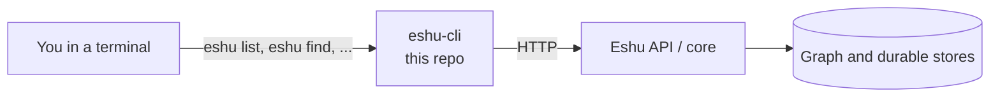

# eshu-cli

Status: pre-release. You can build and run the `eshu` command today.
Some commands still point you at the core binary. That's expected, not a
bug.

`eshu-cli` is how you talk to Eshu from a terminal. Eshu maps code and
cloud systems into a graph (things and how they connect), and most of us
would rather type `eshu list` than hand-write HTTP calls. So that's the
deal: you run a command, we call the Eshu API, and we print JSON you can
read or pipe into something else. This repo holds the commands and their
API clients. It doesn't store the graph and it doesn't run the server.
That work stays in the core.



Put simply: your keystrokes become an HTTP call, and the reply becomes
output on your screen. Query commands only ever talk over HTTP. A few
setup-flavoured commands (`install`, `index`, `config set`,
`mcp setup --write`) work on local files and binaries instead, and
[Concepts: boundaries](docs/concepts/boundaries.md) draws that line exactly.

## Is this the repo you want?

Use it to query Eshu from a terminal or script, to wire an AI editor up
to Eshu with `eshu mcp setup`, or to work on command output, flags, and
exit codes.

Don't use it to run the server (that's the core or `eshu-api`), for
admin repair work (stub commands will send you to the core binary), or
as a one-command full stack (see
[eshu-deploy](https://github.com/eshu-hq/eshu-deploy)).

## Quickstart

You'll need Go 1.26.10 (see `go.mod`).

```bash
go build -o /tmp/eshu ./cmd/eshu
/tmp/eshu version
export ESHU_SERVICE_URL=http://localhost:8080
export ESHU_API_KEY='change-me'
/tmp/eshu list
```

`eshu version` prints one line, `Eshu <version>` (source builds report
`dev`). If that works, the binary runs. `eshu list` then calls
`GET /api/v0/repositories` against your service and prints the reply, so
a JSON response there means you're connected. Run `/tmp/eshu --help`
any time you want the full command list.

## Documentation

| Guide | What you will find |
| --- | --- |
| [Documentation index](docs/README.md) | The map of every page below |
| [Getting started](docs/getting-started/README.md) | Build the binary and answer your first command |
| [Guides](docs/guides/README.md) | Operate, credentials and profiles, and troubleshooting, step by step |
| [Concepts](docs/concepts/README.md) | How a command becomes an HTTP call, and which commands touch local files instead |
| [Configuration reference](docs/reference/configuration.md) | Flags, env vars, profiles, saved settings, and exit codes |
| [Architecture](docs/architecture/README.md) | Place in Eshu, components, and stack |
| [Diagrams](docs/diagrams/README.md) | Every diagram, with captions and text versions |
| [Release](docs/release.md) | Versioned binaries, checksums, and upgrades |
| [CLI contract](docs/contract/8874-eshu-cli-contract.md) | Supported version pairs, credentials, and boundaries |
| [Command inventory](docs/contract/cli_extraction_inventory.md) | Every command, flag, and exit behaviour, classified |
| Maintainer history: [provenance](docs/contract/PROVENANCE.md) and the pin notes (`docs/install-pin.md`, `docs/tier1-pin.md`, `docs/tier2-pin.md`, `docs/tier3-pin.md`) | Source pins and the extraction record for each tier |

## Related repos

`eshu` holds the core. `eshu-api` is the HTTP front door, `eshu-mcp`
serves tools to AI assistants, and
[eshu-deploy](https://github.com/eshu-hq/eshu-deploy) runs the full
stack.

## Development

`make ci` runs the same checks as CI (lint, test, race). Go files stay
at or under 500 lines.

## Contributing, security, and license

See [CONTRIBUTING.md](CONTRIBUTING.md) for the local checks and
[SECURITY.md](SECURITY.md) if you need to report a vulnerability (please
don't use a public issue). There's no `LICENSE` file; sources carry
`SPDX-License-Identifier: MIT`. And please never commit credentials or
`.env` files.
