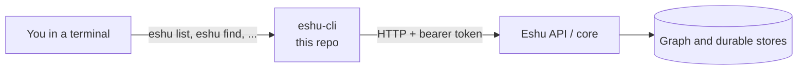

# eshu-cli

Status: pre-release. You can build and run the `eshu`
command today. Some commands still tell you to use the
core binary. That message is expected, not a bug.

`eshu-cli` is the Eshu command-line tool. You type a
command, it calls the Eshu API, and it prints the result.

## What this is and why it exists

Eshu maps code and cloud systems into a graph (things
and how they connect). Most people do not want to write
raw HTTP calls to read that map. This tool does it for you.

You run commands like `eshu list` or `eshu find`.
The tool sends an HTTP request to a running Eshu service.
It prints JSON (a text data format) you can read or pipe
into other tools.

This repo holds the user commands and their API clients.
It does not store the graph. It does not run the server.
Server work stays in the Eshu core.

## How it fits together



Text version: you run a command. The CLI (command-line
interface) turns it into an HTTP call to the Eshu API.
The API talks to the core. The CLI prints the reply.

## When to use it, and when not to

Use this repo when you:

- Want to query Eshu from a terminal or a script.
- Want to set up an AI editor to talk to Eshu
  (`eshu mcp setup` writes the client config for you).
- Work on command output, flags, or exit codes.

Do not use this repo when you:

- Need to run the server. Use the core or `eshu-api`.
- Need admin repair or bootstrap work. Those stay in
  the core binary. Stub commands will point you there.
- Want one command that runs the whole stack. See
  [eshu-deploy](https://github.com/eshu-hq/eshu-deploy).

## Quickstart

You need Go. Use the version in `go.mod` (Go 1.26.10).

Build the binary:

```bash
go build -o /tmp/eshu ./cmd/eshu
/tmp/eshu version
```

You should see one line. The version text depends on
how the binary was built:

```text
Eshu <version>
```

List every command:

```bash
/tmp/eshu --help
```

Your first real query needs a running Eshu service.
Point the CLI at it, then list what is indexed:

```bash
export ESHU_SERVICE_URL=http://localhost:8080
export ESHU_API_KEY='change-me'
/tmp/eshu list
```

`eshu list` calls `GET /api/v0/repositories` and prints
the JSON reply. If nothing is indexed yet, ask your
operator how indexing is run in your setup. Indexing
itself is owned by core tooling, not this repo.

Set up an AI editor client (optional):

```bash
/tmp/eshu mcp setup --help
```

Run it without `--help` to generate the config snippet
for your client. See How it works for the shape.

## How it works

Each command maps to HTTP calls. For example:

- `eshu list` (or `eshu ls`) reads the repository list.
- `eshu index-status` reads the latest indexing status.
- `eshu query <query>` posts a language query.
- `eshu stats [path]` reads indexing statistics.

Other families (`analyze`, `find`, `change`, `map`, `trace`,
`freshness`, `playbooks`, `report`, `component`) follow the same
pattern. Run `eshu --help` for the full list, and
`eshu <command> --help` for its flags.

Two kinds do not call the API. Removed commands (for example
`delete`, `clean`) print what to use instead. Stub commands
(shown as `STUB:` in `--help`) mean the work still lives in
the core binary. Follow the message. Do not guess around it.

`eshu mcp setup` generates MCP client config. MCP (Model
Context Protocol) is how AI assistants call tools. Hosted
snippets point at `<service>/mcp/message` with a bearer header.
Local snippets start `eshu mcp start` over stdio (standard
input and output). Snippets use an env-var reference, never
your raw secret.

Exit codes tell scripts what happened:

| Code | Meaning |
| --- | --- |
| 0 | Success |
| 1 | Generic failure (also the default for errors with no code) |
| 2 | Invalid argument |
| 3 | Ambiguous request |
| 4 | Index building or stale |
| 5 | Degraded or partial result |
| 6 | Unsupported capability |

## Configuration

Values resolve in this order: flags first, then your
saved config, then env vars, then the default.

| Name | Required | Default | Meaning |
| --- | --- | --- | --- |
| `--database` (global) | No | empty | Temporarily override the database backend for this run. |
| `--visual` / `-V` (global) | No | `false` | Show results as an interactive graph where supported. |
| `--version` / `-v` | No | `false` | Print the version and exit. |
| `--service-url` (some commands) | No | from config/env | API service URL. Overrides saved config. |
| `--api-key` (some commands) | No | from config/env | API key for this run. Prefer env or saved config in scripts. |
| `--profile` (some commands) | No | empty | Named config profile, for example `staging`. |
| `ESHU_SERVICE_URL` (env) | No | `http://localhost:8080` | Base URL of the Eshu service. |
| `ESHU_API_KEY` (env) | No | empty | Bearer token sent as `Authorization: Bearer <key>`. Sent only when set. |
| `ESHU_REMOTE_TIMEOUT_SECONDS` (env) | No | `30` | HTTP timeout in seconds. |
| `ESHU_HOME` (env) | No | `~/.eshu` | Config directory. A leading `~` is expanded. |

Saved values live in `~/.eshu/.env` (keep it private, mode
`0600`). A profile reads a suffixed key first: profile `staging`
reads `ESHU_SERVICE_URL_STAGING` before `ESHU_SERVICE_URL`.
Per-command flags vary. Trust `eshu <command> --help` over this table.

## Deploy and run

This is a client tool. You install it where you work.
You do not deploy it as a server.

From source:

```bash
go build -o /tmp/eshu ./cmd/eshu
```

From the image in this repo (binary only, no shell):

```bash
docker build -t eshu-cli:dev .
docker run --rm eshu-cli:dev --help
```

Tagged releases publish `eshu-linux-x86_64` and
`eshu-macos-arm64` binaries. See
[release notes](docs/release.md) for download and
checksum steps.

For a full-stack deploy (server plus services), use
[eshu-deploy](https://github.com/eshu-hq/eshu-deploy).
This repo ships only the client.

## Eshu dependencies

|  | What |
| --- | --- |
| Needs | A reachable Eshu HTTP service for query commands. A valid API key if that service requires one. |
| Talks to | The Eshu API over HTTP. It asks for the `application/eshu.envelope+json` shape where a command uses envelopes. |
| Never touches | The graph store, database tables, or queues directly. It holds no server storage handles. All reads and writes go through HTTP. |

## Operations

There is no health endpoint. This binary is a client.
Check it like this:

```bash
eshu version        # binary runs
eshu doctor         # diagnostics for health and config
eshu list           # service is reachable and accepts your key
```

Common failures: `request failed` means the URL is wrong or
nothing listens there (check `ESHU_SERVICE_URL`). `API error 401`
means your key is missing or wrong. A `STUB:` message means that
family still lives in the core binary. `eshu index` needs
`eshu-bootstrap-index` in your `PATH`.

## Development

Run the same checks as CI:

```bash
make ci       # lint, test, race
make lint     # file cap, vet, golangci-lint, tidy check
make test     # go build ./... and go test ./...
make race     # race tests plus the coverage gate
```

Go files must stay at or under 500 lines (`make filecap` is part
of `make lint`). Dependencies are pinned in `go.mod`, including
`github.com/spf13/cobra` and the `eshu-sdk/wirecontract` module.

## Docs and related repos

- [Release](docs/release.md) — binaries, checksums, upgrades.
- [CLI contract](docs/contract/8874-eshu-cli-contract.md) —
  version pairs, credentials, and boundaries.
- [Command inventory](docs/contract/cli_extraction_inventory.md) —
  every command, flag, and exit behavior.
- [Provenance](docs/contract/PROVENANCE.md) — source pins.

Related: `eshu` (core), `eshu-api` (HTTP front door),
`eshu-mcp` (AI-assistant tools), and
[eshu-deploy](https://github.com/eshu-hq/eshu-deploy)
(full-stack deploys).

## Contributing, security, and license

See [CONTRIBUTING.md](CONTRIBUTING.md) for CI lanes and local checks.
See [SECURITY.md](SECURITY.md) to report a vulnerability (not a public
issue). No `LICENSE` file; sources carry `SPDX-License-Identifier: MIT`.
Never commit credentials or `.env` files.
