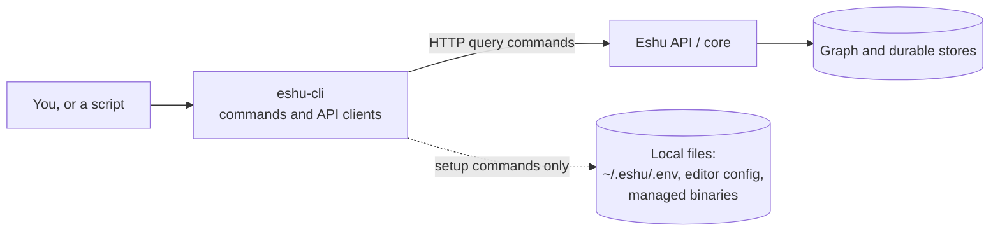
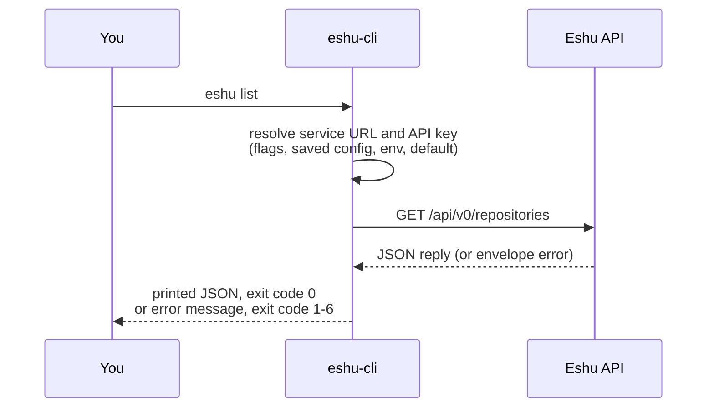

# Diagrams: eshu-cli

Every diagram for this repo lives on this page, each with a caption and
a text version so the story survives even where Mermaid doesn't render.
Other pages link here instead of carrying their own copies. The repo
[README](../../README.md) keeps the first one as its single picture.

## Where eshu-cli sits

*Two paths out of the CLI: queries go right over HTTP, setup goes down to your disk.*

Text version: you (or a script) run a command in `eshu-cli`. Query
commands go over HTTP to the Eshu API / core, which alone talks to the
graph and durable stores. A few setup commands instead act on local
files: `~/.eshu/.env`, editor config, and managed binaries. Nothing in
this repo goes straight into the graph store — see
[Boundaries](../concepts/boundaries.md) for exactly which commands
take which path.

## Following one command through

*From keystroke to HTTP call to printed JSON.*

Text version:

1. You run `eshu list`.
2. We resolve the service URL and API key: flags first, then saved
   config in `~/.eshu/.env`, then env vars, then the built-in default.
3. We call `GET /api/v0/repositories`.
4. The JSON reply prints with exit code `0`. An envelope error prints
   a message and maps to exit code `1`–`6`, so scripts can branch on
   "index still building" separately from "you typed that wrong" —
   the table is in
   [Reference: configuration](../reference/configuration.md).

See also: [Request story](../concepts/request-story.md).
